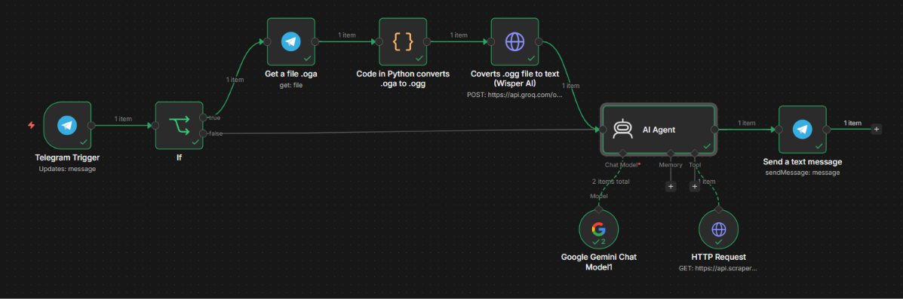
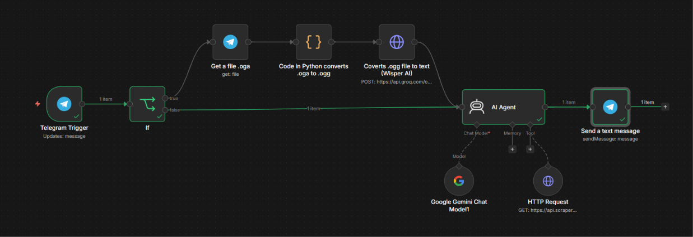
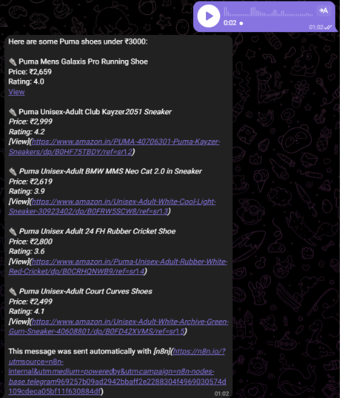
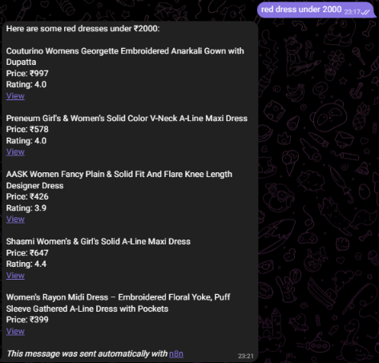
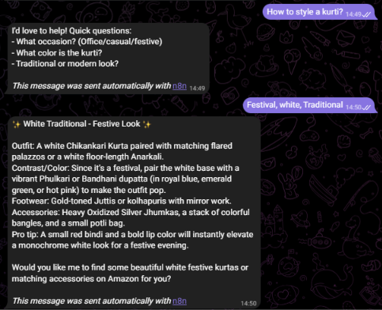

# 🛍️ Multimodal AI Shopping & Styling Assistant (Telegram Agent)

A multimodal **Telegram AI Agent** built with **n8n** that handles both **voice notes** and **text messages** to act as a live **Amazon India (`amazon.in`)** product finder and personal fashion stylist. Powered by **Google Gemini (`gemini-2.5-flash`)**, **Groq Whisper (`whisper-large-v3-turbo`)**, and **ScraperAPI**.

## ⚙️ How It Works

1. **Telegram Trigger (`updates: message`):** Listens for incoming text messages or voice notes sent to your Telegram bot.
2. **Input Routing (`If` Node):** Checks whether `$json.message.voice` exists and routes the execution down one of two paths:
   * **Voice Path (`true`):**
     1. **Download Audio (`Get a file .oga`):** Fetches the Telegram voice note binary file.
     2. **Format Conversion (`Code in Python converts .oga to .ogg`):** Renames the `.oga` file extension to `.ogg` in Python so it is accepted by transcription APIs.
     3. **Speech-to-Text (`Coverts .ogg file to text (Wisper AI)`):** Transcribes the `.ogg` voice note to English text via **Groq (`whisper-large-v3-turbo`)**.
   * **Text Path (`false`):** Passes `$json.message.text` directly to the AI Agent.
3. **Dual-Mode AI Agent (`AI Agent` + `Google Gemini Chat Model1`):** Powered by **`models/gemini-2.5-flash`**, the agent dynamically switches between two modes:
   * **Product Search Mode:** Constructs an `https://amazon.in...` search URL, calls **ScraperAPI** (`cssSelector: div[data-component-type="s-search-result"]`) to scrape live product listings, and returns the top 5 results with prices, ratings, and direct links.
   * **Styling Consultant Mode:** Asks clarifying questions (occasion, color, traditional vs. modern style) and delivers tailored outfit, footwear, and accessory recommendations before offering to search Amazon for matching items.
4. **Telegram Reply (`Send a text message`):** Sends the formatted product list or styling guide back to the user on Telegram.

### Execution Flows
* **Voice-Note Execution Path:**
  
* **Text-Message Execution Path:**
  

## 📱 Sample Telegram Conversations

| Voice Search (`"Puma shoes under ₹3000"`) | Text Search (`"red dress under 2000"`) | Styling Consultation (`"How to style a kurti?"`) |
| :---: | :---: | :---: |
|  |  |  |

## 🔑 Required Credentials & API Keys

Configure the following in n8n after importing the workflow:
* **Telegram Bot API:** Required for `Telegram Trigger`, `Get a file .oga`, and `Send a text message` (create a bot via `@BotFather`).
* **Groq API Key:** Required in `Coverts .ogg file to text (Wisper AI)` under the `Authorization` header (`Bearer YOUR_GROQ_API_KEY`).
* **Google Gemini (PaLM) API:** Required for `Google Gemini Chat Model1` (`models/gemini-2.5-flash`).
* **ScraperAPI Key:** Required in the `HTTP Request` tool node under the `api_key` query parameter.

## 🛠️ Setup Instructions

1. Import `workflow.json` into your n8n instance.
2. Open **Telegram Trigger**, **Get a file .oga**, and **Send a text message**, attach your Telegram Bot credentials, and set your `Chat ID` (or map `={{ $('Telegram Trigger').item.json.message.chat.id }}`).
3. Open **Coverts .ogg file to text (Wisper AI)** and replace `YOUR_GROQ_API_KEY` with your [Groq](https://groq.com) API key.
4. Open **Google Gemini Chat Model1** and attach your Google Gemini API credentials.
5. Open the **HTTP Request** tool node and replace `YOUR_SCRAPERAPI_KEY` with your [ScraperAPI](https://scraperapi.com) key.
6. Toggle the workflow to **Active** and send a text message or voice note to your Telegram bot!
