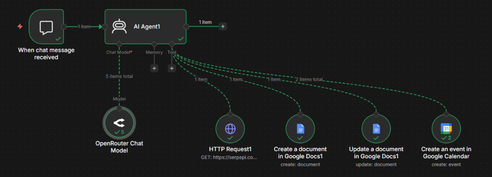

# 🗺️ Learning Path Generator Agent

An autonomous **n8n AI Agent** that takes any learning goal via chat (e.g., *"Generate 2 days roadmap for JS"*), searches the web for real tutorials, documentation, and video courses via **SerpApi**, builds a structured day-by-day curriculum in **Google Docs**, and automatically schedules daily 2-hour study blocks on **Google Calendar** using **OpenRouter (`deepseek-v4-flash-latest`)**.

## ⚙️ How It Works

1. **Chat Trigger (`When chat message received`):** Accepts a natural-language learning request (topic, duration in days, and optional start date).
2. **Autonomous Multi-Tool Orchestration (`AI Agent1` + `OpenRouter Chat Model`):** Powered by **`deepseek/deepseek-v4-flash-latest`** via **OpenRouter**, the agent dynamically resolves dates relative to `{{ $now }}` (`Asia/Kolkata` / `+05:30` timezone) and executes a 4-tool sequence:
   * **Step 1 — Web Resource Search (`HTTP Request1` / SerpApi):** Queries Google Search (`https://serpapi.com`) to extract verified `https://` links for beginner tutorials, official documentation, and YouTube courses.
   * **Step 2 — Create Curriculum Doc (`Create a document in Google Docs1`):** Generates a new Google Doc titled `"[X]-Day [Topic] Learning Path"` inside your target Google Drive folder.
   * **Step 3 — Populate Day-Wise Content (`Update a document in Google Docs1`):** Inserts structured daily modules containing topic descriptions, key learning points, 2-hour duration blocks, and verified reference URLs.
   * **Step 4 — Schedule Study Sessions (`Create an event in Google Calendar`):** Loops through Day 1 to Day X and books dedicated 2-hour calendar blocks (`11:00 AM – 1:00 PM +05:30`) with each day's summary and study links in the event description.
3. **Final Chat Summary:** Returns the direct Google Docs URL and confirms the exact date range scheduled on Google Calendar.

## 📄 Sample Execution (`"Generate 2 days roadmap for JS"`)

* **Generated Curriculum Document:** *2-Day JavaScript Learning Path*
  
* **Scheduled Study Blocks:** 2 daily 2-hour sessions added to Google Calendar
  

## 🔑 Required Credentials & API Keys

Configure the following in n8n after importing the workflow:
* **OpenRouter API:** Required for the `OpenRouter Chat Model` sub-node (`deepseek/deepseek-v4-flash-latest`).
* **SerpApi API Key:** Required in `HTTP Request1` under the `api_key` query parameter.
* **Google Docs OAuth2:** Required for both `Create a document in Google Docs1` and `Update a document in Google Docs1`.
* **Google Calendar OAuth2:** Required for `Create an event in Google Calendar`.

## 🛠️ Setup Instructions

1. Import `workflow.json` into your n8n instance.
2. Open **OpenRouter Chat Model** and attach your OpenRouter API credentials.
3. Open **HTTP Request1** (SerpApi) and replace `YOUR_SERPAPI_KEY` in the `api_key` query parameter with your [SerpApi](https://serpapi.com) key.
4. Open **Create a document in Google Docs1** and **Update a document in Google Docs1**, connect your Google Docs OAuth2 account, and select your target **Folder**.
5. Open **Create an event in Google Calendar**, connect your Google Calendar OAuth2 account, and select your target **Calendar**.
6. Click **Open Chat**, enter a prompt like `"Generate 2 days roadmap for JS"`, and inspect your generated Google Doc and Calendar events.
