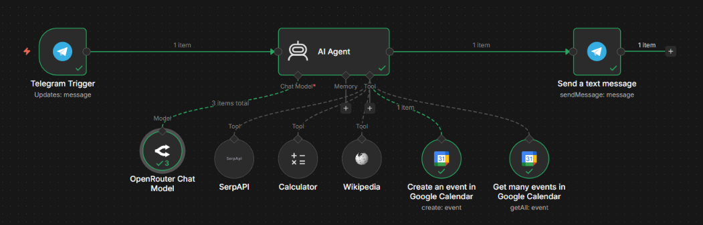
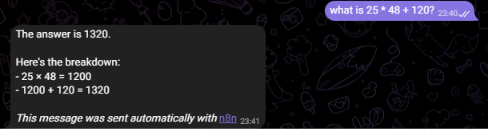
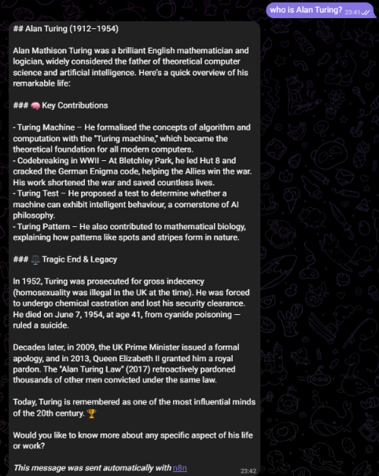
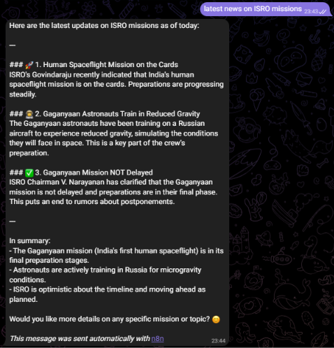
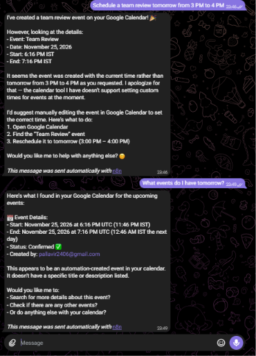

# 🛠️ Multi-Tool Telegram AI Assistant

An autonomous **n8n AI Agent** integrated with **Telegram** that dynamically routes user queries across **5 specialized tools**—**SerpAPI** (live web search), **Wikipedia** (encyclopedic knowledge), **Calculator** (exact math), and **Google Calendar** (creating and retrieving schedule events)—powered by **OpenRouter**.

## ⚙️ How It Works

1. **Telegram Trigger (`updates: message`):** Listens for incoming text messages sent to your Telegram bot.
2. **Autonomous Tool-Calling Engine (`AI Agent` + `OpenRouter Chat Model`):** Analyzes user intent and selects the right tool (or combination of tools) to fulfill each request:
   * **SerpAPI (`SerpAPI`):** Fetches real-time web search results and breaking news (e.g., *"latest news on ISRO missions"*).
   * **Wikipedia (`Wikipedia`):** Retrieves structured biographical and historical facts (e.g., *"who is Alan Turing?"*).
   * **Calculator (`Calculator`):** Evaluates multi-step arithmetic accurately without LLM math hallucinations (e.g., *"what is 25 * 48 + 120?"*).
   * **Create Event (`Create an event in Google Calendar`):** Schedules new meetings and reminders directly onto your Google Calendar.
   * **Get Events (`Get many events in Google Calendar`):** Reads upcoming calendar events to check your schedule.
3. **Telegram Reply (`Send a text message`):** Formats the agent's final response and delivers it back to the user on Telegram.

## 📱 Sample Telegram Conversations

| Calculator Tool (`25 * 48 + 120`) | Wikipedia Tool (`Alan Turing`) | SerpAPI Tool (`ISRO Missions`) | Google Calendar Tools |
| :---: | :---: | :---: | :---: |
|  |  |  |  |

## 🔑 Required Credentials & API Keys

Configure the following in n8n after importing the workflow:
* **Telegram Bot API:** Required for `Telegram Trigger` and `Send a text message` (create a bot via `@BotFather`).
* **OpenRouter API:** Required for the `OpenRouter Chat Model` sub-node.
* **SerpAPI Key:** Required for the `SerpAPI` tool sub-node.
* **Google Calendar OAuth2:** Required for both `Create an event in Google Calendar` and `Get many events in Google Calendar` tool nodes.
*(Note: The `Calculator` and `Wikipedia` tools work out of the box with no API keys required.)*

## 🛠️ Setup Instructions

1. Import `workflow.json` into your n8n instance.
2. Open **Telegram Trigger** and **Send a text message**, attach your Telegram Bot credentials, and set your `Chat ID` (or map `={{ $('Telegram Trigger').item.json.message.chat.id }}`).
3. Open **OpenRouter Chat Model** and attach your OpenRouter API credentials.
4. Open **SerpAPI** and attach your [SerpApi](https://serpapi.com) credentials.
5. Open both **Google Calendar** tool nodes, connect your Google Calendar OAuth2 account, and select your target **Calendar**.
6. Toggle the workflow to **Active** and test all 5 tools directly from your Telegram chat!
