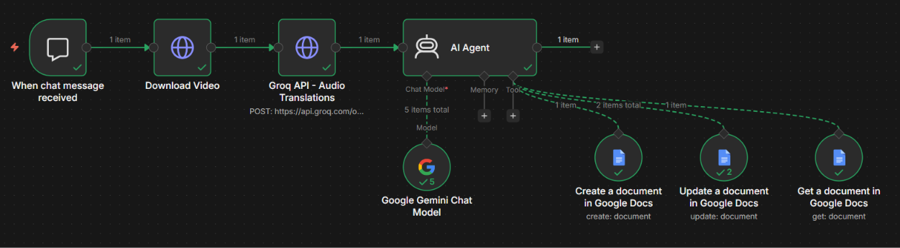

# 📝 Transcription Summarizer Agent

An autonomous **n8n AI Agent** that accepts a video or audio URL via chat, transcribes the spoken content using **Groq (`whisper-large-v3`)**, and orchestrates a 4-step **Google Docs** tool-calling sequence powered by **Google Gemini (`gemini-3.1-flash-lite`)** to archive the full transcript, append a structured summary, verify the final document, and return both the live Google Doc link and key takeaways in chat.

## ⚙️ How It Works

1. **Chat Trigger (`When chat message received`):** Accepts a direct `.mp4` or audio file URL pasted into the n8n chat window.
2. **Media Ingestion (`Download Video`):** Fetches the remote video/audio file via `GET` request as binary data.
3. **Speech-to-Text Transcription (`Groq API - Audio Translations`):** Sends the binary media file to `https://groq.com` (`whisper-large-v3`) to generate a complete text transcript.
4. **Autonomous Tool-Calling Loop (`AI Agent` + `Google Gemini Chat Model`):** Powered by **`models/gemini-3.1-flash-lite`**, the agent autonomously executes a strict 5-step tool sequence:
   * **Step 1 (`Create a document in Google Docs`):** Creates a new titled Google Doc in your designated Google Drive folder.
   * **Step 2 (`Update a document in Google Docs`):** Inserts the full raw transcript into the document.
   * **Step 3 (`Update a document in Google Docs`):** Analyzes the transcript and appends a structured bullet-point summary covering key themes, insights, action items, conclusions, and notable data.
   * **Step 4 (`Get a document in Google Docs`):** Reads back the complete document to verify that both the original transcript and summary were saved properly.
   * **Step 5 (Chat Response):** Extracts and returns the shareable Google Doc URL alongside the formatted bullet-point summary directly in chat.

## 📄 Sample Execution

* **Sample Input Video:** [Worried AI might take over your tech job 🤔.mp4](https://new-assets.ccbp.in/frontend/loading-data/niat-course-projects/Worried%20AI%20might%20take%20over%20your%20tech%20job%20%20%F0%9F%A4%94.mp4)
* **Generated Google Doc:** *Knowledge Work & AI Impact - Discussion Notes*
* **Key Takeaways Extracted by Agent:**
  * Growing discussion around AI's impact on knowledge work (writing, thinking, and research).
  * Enterprise examples (such as Pega) already demonstrate AI handling routine knowledge tasks at scale.
  * AI augments rather than replaces knowledge workers, freeing humans to focus on complex reasoning and problem-solving.

## 🔑 Required Credentials & API Keys

Configure the following in n8n after importing the workflow:
* **Groq API Key:** Required in `Groq API - Audio Translations` under the `Authorization` header (`Bearer YOUR_GROQ_API_KEY`).
* **Google Gemini (PaLM) API:** Required for the `Google Gemini Chat Model` sub-node (`models/gemini-3.1-flash-lite`).
* **Google Docs OAuth2:** Required across all three Google Docs tool nodes (`Create`, `Update`, and `Get`).

## 🛠️ Setup Instructions

1. Import `workflow.json` into your n8n instance.
2. Open **Groq API - Audio Translations** and replace `YOUR_GROQ_API_KEY` in the `Authorization` header with your [Groq](https://groq.com) API key.
3. Open **Google Gemini Chat Model** and attach your Google Gemini API credentials.
4. Open all three **Google Docs** tool nodes, connect your Google Docs OAuth2 account, and select your target **Folder** in the `Create a document in Google Docs` node.
5. Click **Open Chat**, paste a direct `.mp4` or `.mp3` URL, and watch the agent create, populate, verify, and return your summarized Google Doc.
